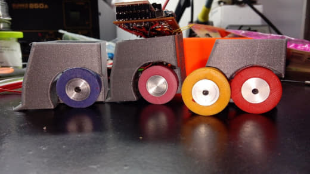

# Modelo 3D, licencia

## Chasis (microsumo)

El chasis impreso procede de **Cults3D** y **no está incluido** en este
repositorio:

- Origen: <https://cults3d.com/es/modelo-3d/juegos/robot-microsumo>
- La tirada de impresión de referencia (PLA, 0.2 mm, Ender 3, ~3 h 18 min)
  fue generada a partir de ese modelo con Cura.

Imprímelo tú mismo desde el enlace original si quieres montar el robot completo.

## Ruedas

Las ruedas **originales** del kit eran **torneadas a mano por Esdrufao**. Aquí
se aporta el **diseño 3D de la rueda** (`rueda_thorhija.skp`, SketchUp). Las
**gomas** se hacían a mano para darle tracción. Este modelo puede distribuirse
bajo la licencia del repo (GPL-3.0).

