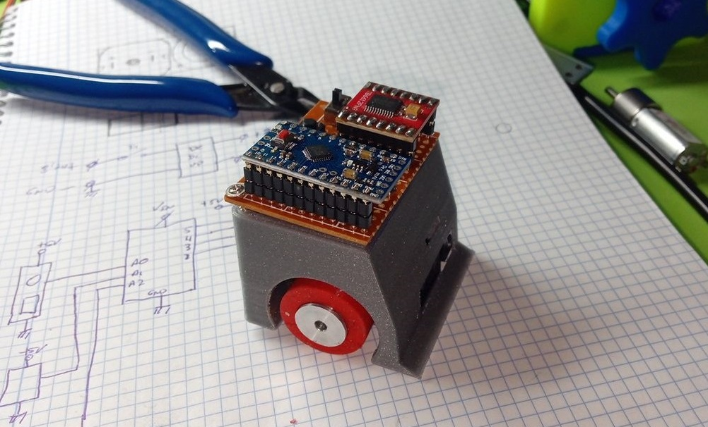
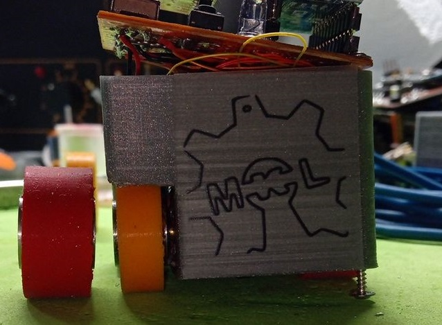

# THOR-HIJA

Robot de **Microsumo** (5×5×5 cm, < 100 g): el kit de [LEM ROBOTICS](https://www.youtube.com/watch?v=JZTX_83l-D0) diseñado por **Esdrufao** (2020).

El nombre `THOR-HIJA` viene del chiste del grupo, *"hija de Thor, torrija"*.

<table>
<tr>
<td>  </td>
<td>  </td>
</tr>
</table>

## Hardware
- **Arduino Pro Mini** (ATmega328P, 5 V / 16 MHz)
- **Driver de motores TB6612FNG** (doble puente H)
- 2× **Motores N20** (3 V / 6 V) con reducciones típicas de robótica
- 2× **sensores de reflectancia QTR-1A** (analógicos) para el borde del dohyō → pines A1/A2
- 1× **sensor de oponente Sharp GP2Y0A21YK** (IR, salida analógica, 10–80 cm) → pin A0
- Receptor **IR** (mando blanco de arranque) → pin D11
- LEDs de cuenta atrás (rojo/amarillo/verde) + botón **START** en placa
- Ruedas originales **torneadas a mano por Esdrufao**; el repo incluye el **diseño 3D** de la rueda (ver [3d_model](./3d_model/))
- Chasis impreso en **PLA** (modelo de Cults3D, ver [3d_model](./3d_model/))
- Alimentación: 1S LiPo 3.7 V o 2S ≈ 7.4 V (configurable por puente en la PCB)

Pinout completo en [docs/01-hardware.md](docs/01-hardware.md).

## Software

- Escrito en **Arduino (C++)** con el IDE de Arduino.
- Librerías: [Pololu/QTRSensors](https://github.com/pololu/qtr-sensors-arduino) y [SparkFun_TB6612](https://github.com/sparkfun/SparkFun_TB6612FNG_Arduino_Library).
- `source_code/THOR-HIJA/THOR-HIJA.ino`, firmware principal (lectura de sensores, detección de borde y de oponente).
- `source_code/tests/`, sketches de prueba individuales:
  - `sharp_filtro`, lectura promediada del Sharp (A0).
  - `sharp_led`, detección de oponente con umbral y LED de prueba (pin 9).
  - `IR/REMOTO.ino`, lectura de códigos del mando IR por serie.
  - `IR/codigos_mando_blanco.txt`, códigos del mando blanco.

## Documentación

- [Hardware y pinout](docs/01-hardware.md), componentes, alimentación y conexionado
- [Firmware](docs/02-firmware.md), estructura del código, librerías y cómo flashear
- [Sensores](docs/03-sensores.md), QTR de borde y SHARP de oponente: lecturas, umbrales y calibración
- [Mando IR](docs/04-comunicacion-ir.md), receptor, protocolo y códigos del mando blanco
- [PCB](docs/05-pcb.md), diseño en Proteus, capas, gerbers y puente de alimentación

Documentación completa en [docs/index.md](docs/index.md).

## Estructura del repositorio

```
THOR-HIJA/
├── source_code/          # Firmware Arduino (principal + tests)
├── pcb_files/            # Proyecto Proteus (esquema + layout) y gerbers
├── 3d_model/             # Ruedas del robot
├── images/               # Fotografías y renders (wheel, PCB, esquema)
└── docs/                 # Documentación técnica
```

## Stack tecnológico

| Elemento          | Tecnología                          |
|-------------------|-------------------------------------|
| Microcontrolador  | ATmega328P (Arduino Pro Mini)       |
| Driver de motores | TB6612FNG                           |
| Framework         | Arduino IDE                         |
| Lenguaje          | C++ (sketch .ino)                   |
| Diseño de PCB     | Proteus 8 (ARES)                    |
| Fabricación PCB   | Gerbers `pcb_files/gerbers_files/`  |

## Créditos y licencia

- Diseño original (esquema y PCB del kit): **Esdrufao**, LEM ROBOTICS.
- Vídeo de montaje en directo: [#EFS 6 – Encendemos el soldador y montamos un kit de LEM ROBOTICS](https://www.youtube.com/watch?v=JZTX_83l-D0).
- El **chasis 3D** es de [Cults3D](https://cults3d.com/es/modelo-3d/juegos/robot-microsumo).
- Código y documentación: licencia **GPL-3.0** (ver [LICENSE](LICENSE)).