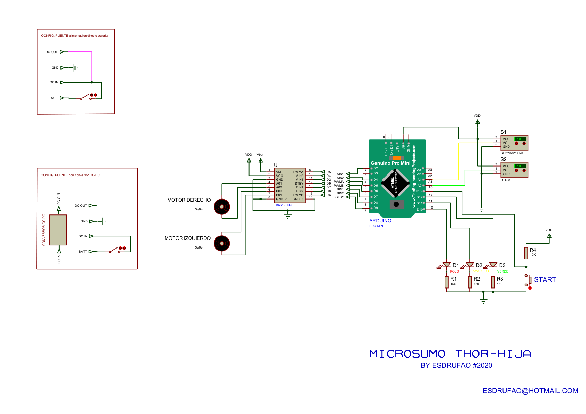

[← Volver al índice](index.md)

# 01, Hardware y pinout

## Características

| Especificación | Valor |
|---|---|
| Dimensiones | 5 × 5 × 5 cm (máx. categoría microsumo) |
| Peso | < 100 g |
| Microcontrolador | Arduino Pro Mini (ATmega328P, 5 V / 16 MHz) |
| Driver de motores | TB6612FNG (doble puente H, 1.2 A) |
| Motores | 2× N20 de 3 V / 6 V |
| Sensores de línea | 2× Pololu QTR-1A (reflectancia analógica) |
| Sensor de oponente | Sharp GP2Y0A21YK (IR analógico, 10–80 cm) |
| Receptor IR | TSOP (compatible 38 kHz), externo a la PCB |
| Alimentación | 1S LiPo 3.7 V o 2S 7.4 V (puente en PCB) |

## Esquema de conexiones



```
                    +-------------------------------+
  A0  <------------ | SHARP GP2Y0A21 (oponente)     |
  A1  <------------ | QTR-1A canal 1 (reflexión)    |
  A2  <------------ | QTR-1A canal 2 (reflexión)    |
                    |                               |
  Arduino Pro Mini  |  TB6612FNG                    |
  ----------------  |  ----------                   |
  D2  ------------> | AIN1    AO1 +------> Motor A  |
  D4  ------------> | AIN2    AO2 -------> (derecho)|
  D5  (PWM) ------> | PWMA                        |
  D7  ------------> | BIN1    BO1 +------> Motor B  |
  D8  ------------> | BIN2    BO2 -------> (izquierdo)|
  D6  (PWM) ------> | PWMB                        |
  D9  ------------> | STBY                       |
  D11 <------------ | Receptor IR (TSOP, GND/5V)   |
                    +-------------------------------+
```

## Pinout completo

| Arduino (Pro Mini) | Señal            | Notas                                   |
|--------------------|------------------|-----------------------------------------|
| `A0`               | SHARP VO         | Salida analógica del sensor de oponente |
| `A1`/`A2`          | QTR-1A (×2)      | Sensores de línea (reflectancia)        |
| `D2`/`D4`          | AIN1 / AIN2      | Entradas canal A del TB6612             |
| `D7`/`D8`          | BIN1 / BIN2      | Entradas canal B del TB6612             |
| `D5`               | PWMA (PWM)       | Velocidad canal A                       |
| `D6`               | PWMB (PWM)       | Velocidad canal B                       |
| `D9`               | STBY            | Standby (a HIGH para habilitar)         |
| `D10`              | *(estado)*       | Indicador de avance en el firmware      |
| `D11`              | IR RX            | Receptor del mando (solo en test)       |

> **Canales de motor** (según el esquemático `microsumo_thor_rija`):
> el canal A del TB6612 → `MOTOR DERECHO` y el canal B → `MOTOR IZQUIERDO`.

> **LEDs de cuenta atrás y botón START** están presentes en el esquema de la placa
> (D1 rojo, D2 amarillo, D3 verde, R1–R3 de 150 Ω; botón START con R4 de 10 kΩ),
> pero no se usan en el firmware de ejemplo y sus pines no quedan documentados.

## Alimentación

La PCB soporta dos configuraciones mediante un **puente** (jumper/soldadura):

1. **Batería directa**, la batería alimenta directamente el bus de motores (VM del
   TB6612) y el VIN del Arduino. Pensado para 1S 3.7 V con motores de 3 V.
2. **Conversor DC-DC**, la batería entra al conversor (DC IN) y su salida (DC OUT)
   alimenta el robot. Útil con 2S ≈ 7.4 V.

| Net (PCB) | Función |
|---|---|
| `DC IN`  | Entrada de batería hacia el conversor |
| `GND`    | Referencia común |
| `BATT`   | Batería (conexión directa) |
| `DC OUT` | Salida del conversor / alimentación |

---

[Siguiente: 02 - Firmware →](02-firmware.md)