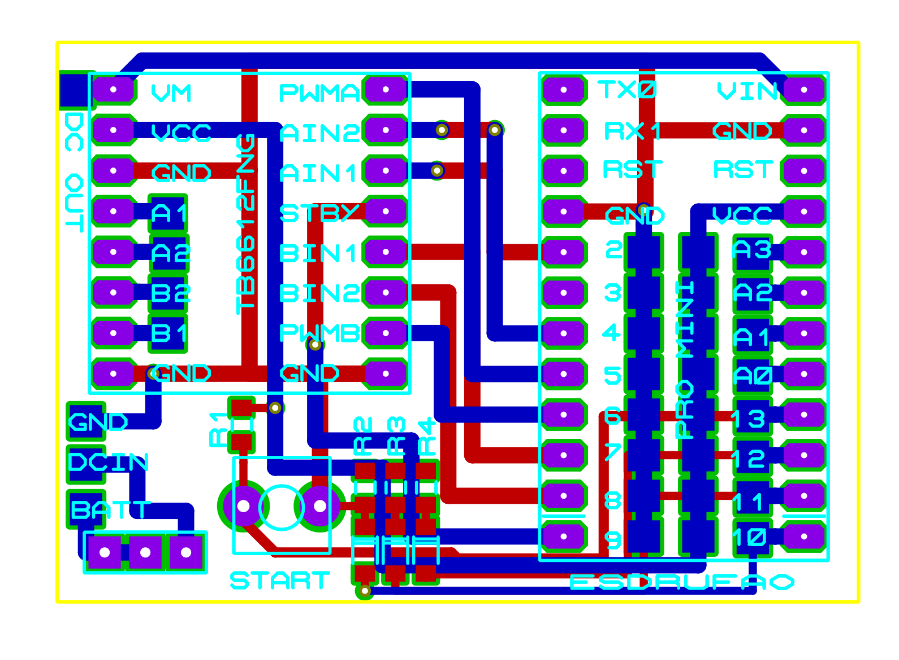
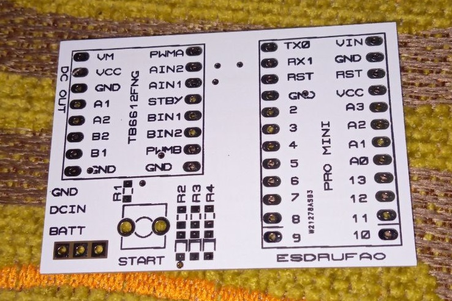

[← Volver al índice](index.md)

# 05, PCB

Diseñada en **Proteus 8 (ARES)** por Esdrufao (2020). La fabricación se hace con
los **gerbers** incluidos en este repositorio.

<p align="center">
  
</p>

<p align="center">
  
</p>

## Proyectos Proteus

| Archivo | Contenido |
|---|---|
| `pcb_files/proteus_project/microsumo_thor_rija.pdsprj` | Proyecto de **esquemático** completo (multihojas) |
| `pcb_files/proteus_project/microsumo_thor_rija.pdsbak` | Copia de seguridad del esquemático |
| `pcb_files/proteus_project/microsumo_thor_rija_schematic.pdf` | Esquemático exportado (A3) |
| `pcb_files/proteus_project/PCB_V1.pdsprj` | Proyecto de **layout** |
| `pcb_files/proteus_project/PCB_V1.LYT` | Layout de la placa |
| `pcb_files/proteus_project/PCB_V1.pdf` | Layout exportado |

> Los ficheros originales usaban espacios y numeración de copias de Proteus
> ("Backup Of…", "Last Loaded…"); se han renombrado con guiones bajos para el repo.

## Características de la placa

- Tamaño aproximado: **56 × 41 mm** (medido sobre el export PDF del layout).
- Doble cara (Top/Bottom copper) con máscara de soldadura y serigrafía top.
- Referencias del esquemático:
  - `U1`, TB6612FNG (driver) → `D2/D4/D5/D7/D8/D6/D9`
  - `S1`, Sharp GP2Y0A21YK → `A0`
  - `S2`, QTR (par de sensores) → `A1`/`A2`
  - `D1` rojo, `D2` amarillo, `D3` verde (LEDs cuenta atrás) → R1–R3 de 150 Ω
  - `R4` de 10 kΩ + botón `START`
  - `MOTOR DERECHO` / `MOTOR IZQUIERDO` (N20 3v/6v)
- Firmado: `BY ESDRUFAO #2020`

## Gerbers

En `pcb_files/gerbers_files/` (y empaquetados en
`THOR-HIJA_PCB_V1_Gerbers.zip`):

| Capa | Fichero |
|---|---|
| Cobre superior | `PCB V1 - CADCAM Top Copper.TXT` |
| Cobre inferior | `PCB V1 - CADCAM Bottom Copper.TXT` |
| Máscara superior | `PCB V1 - CADCAM Top Solder Resist.TXT` |
| Máscara inferior | `PCB V1 - CADCAM Bottom Solder Resist.TXT` |
| Pasta (SMD) sup. | `PCB V1 - CADCAM Top SMT Paste Mask.TXT` |
| Pasta (SMD) inf. | `PCB V1 - CADCAM Bottom SMT Paste Mask.TXT` |
| Serigrafía sup. | `PCB V1 - CADCAM Top Silk Screen.TXT` |
| Taladros | `PCB V1 - CADCAM Drill.TXT` |
| Mecánico | `PCB V1 - CADCAM Mechanical 1.TXT` |

## Configuración de alimentación (puente)

La placa incluye una zona de **4 pads** con dos montajes posibles:

```
  DC IN ── [conversor DC-DC] ──> DC OUT ──> VM/VIN (+ motores)
  BATT ── (puente) ──> DC OUT   ←→   batería directa
         GND
```

- **Sin conversor (directo)**: se puentea `BATT` con `DC OUT` y la batería
  alimenta los motores (VM del TB6612) y el VIN del Arduino. Pensado para
  **1S 3.7 V** con motores de 3 V.
- **Con conversor DC-DC**: la batería entra por `DC IN`, el conversor regula y
  su salida llega a `DC OUT` (perfecto para **2S ≈ 7.4 V**).

Decide la configuración en función de la batería y de los motores (3 V o 6 V).

## Notas de montaje (del vídeo)

- El **Arduino Pro Mini** se monta a presión sin soldar el conector de
  programación (se usa con pines macho).
- Esdrufao avisa de que ciertos **footprints de Proteus** (driver y/o sensor
  QTR) quedaron con separación de patillas ajustada: conviene **verificar
  centrado/huecos** antes de soldar los componentes.
- Las **ruedas** se fabrican con molde de silicona; THOR-HIJA usa las suyas
  propias (`3d_model/rueda_thorhija.skp`).

---

[← 04 - Mando IR](04-comunicacion-ir.md)